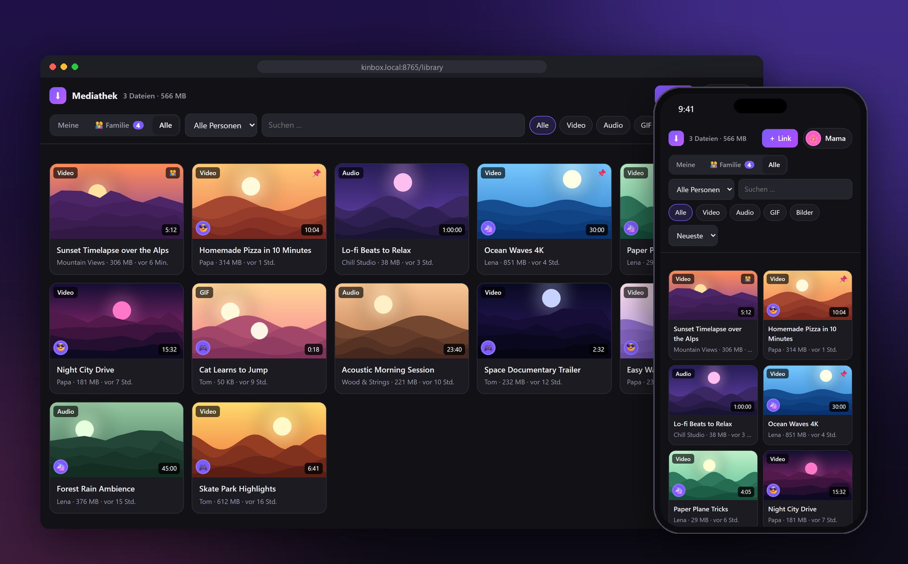
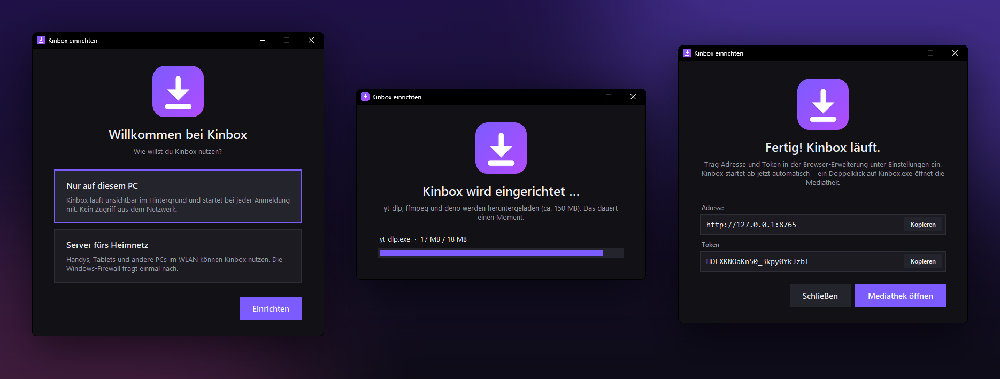
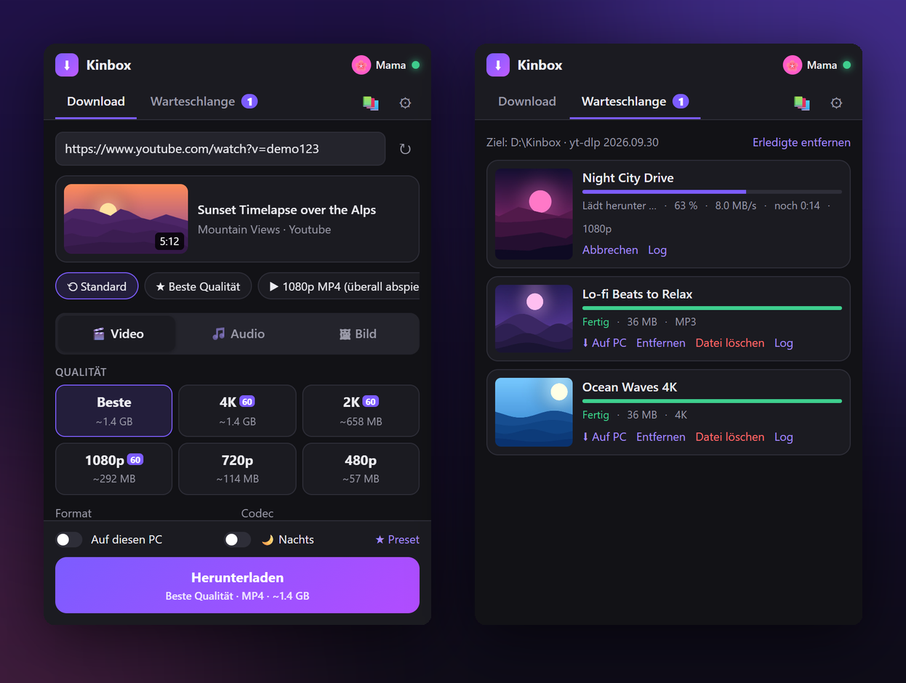
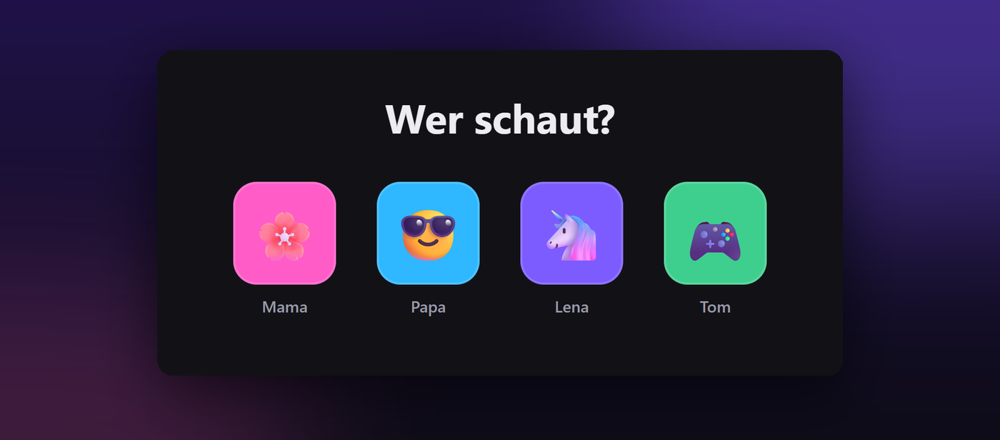

<div align="center">


# Kinbox

**Die Medienkiste für die Familie**

Videos und Musik von YouTube, TikTok & 1.000+ Seiten mit einem Klick auf den eigenen PC laden –<br>mit Browser-Erweiterung, Web-Mediathek und eigenem Profil für jede Person. Ganz ohne Terminal.

[](https://github.com/B4turnatur/Kinbox/releases/latest)
[](https://github.com/B4turnatur/Kinbox/releases)
[](LICENSE)
<br>


🇬🇧 [English](README.md) · 🇩🇪 **Deutsch**

<h3>
  <a href="https://github.com/B4turnatur/Kinbox/releases/latest">⬇️ Kinbox.exe herunterladen</a>
  &nbsp;·&nbsp;
  <a href="#1-server-einrichten-einmalig">🚀 Einrichten</a>
  &nbsp;·&nbsp;
  <a href="#-familie--profile">👨‍👩‍👧 Familie</a>
</h3>

<br>



https://github.com/user-attachments/assets/62fb7eb1-e7ff-404e-94bf-f0cfa957e14a

</div>

<br>

<table>
<tr>
<td width="33%" valign="top">

### 🎬 Ein Klick genügt
Kinbox-Button direkt auf YouTube, TikTok, Instagram, X und Reddit – oder Rechtsklick auf jeder Seite.

</td>
<td width="33%" valign="top">

### 🎚️ Alles einstellbar
Bis 8K & 60 fps, MP3/FLAC, Zuschneiden, Kapitel, Untertitel, Playlists, GIF oder klein für WhatsApp.

</td>
<td width="33%" valign="top">

### 📚 Eigene Mediathek
Suchen, abspielen und aufs Handy laden – im Browser, als App installierbar.

</td>
</tr>
<tr>
<td valign="top">

### 👨‍👩‍👧 Für die ganze Familie
„Wer schaut?“ mit PIN, eigener Ordner, Teilen, Speicher-Kontingent und Einladungslinks.

</td>
<td valign="top">

### 🧹 Räumt selbst auf
Nach dem Laden aufs Gerät, nach X Tagen oder ab einer Größe – pro Person, mit 📌 zum Behalten.

</td>
<td valign="top">

### 🏠 Bleibt bei dir
Läuft auf deinem PC, keine Cloud, kein Konto. Nur dieser PC oder fürs ganze Heimnetz.

</td>
</tr>
</table>

## 1. Server einrichten (einmalig)

### Am einfachsten: Kinbox.exe (Windows, ohne Python)

1. Im [neuesten Release](https://github.com/B4turnatur/Kinbox/releases/latest) **`Kinbox.exe`** und **`Kinbox-Extension.zip`** herunterladen.
2. `Kinbox.exe` in einen eigenen Ordner legen, z. B. `C:\Kinbox`, und doppelklicken. Windows warnt eventuell „Der Computer wurde durch Windows geschützt“. Dann auf **Weitere Informationen → Trotzdem ausführen** klicken. Die exe ist nicht signiert.
3. Ein Einrichtungsfenster öffnet sich. **Nur auf diesem PC** oder **Server fürs Heimnetz** wählen und auf **Einrichten** klicken. Kinbox lädt yt-dlp, gallery-dl, ffmpeg und deno herunter (ca. 160 MB) und legt sie in `tools\` ab. Beim Heimnetz die Nachfrage der Windows-Firewall mit „Zugriff zulassen“ bestätigen.
4. Das Fenster zeigt **Adresse** und **Token** für die Erweiterung an (mit Kopieren-Knopf). Kinbox startet ab jetzt bei der Anmeldung automatisch. Ein erneuter Doppelklick auf `Kinbox.exe` öffnet die Mediathek.

<p align="center"></p>

yt-dlp aktualisierst du in den Einstellungen der Erweiterung mit „yt-dlp aktualisieren“.

**Kinbox selbst** aktualisierst du in der Mediathek als Admin → ⚙ → **Server** → „Jetzt aktualisieren“. Kinbox lädt die neueste Version von GitHub und startet sich selbst neu (geht mit `Kinbox.exe` und mit der Python-Installation; vorher laufende Downloads abwarten). Die Browser-Erweiterung wird weiterhin separat aktualisiert.

### Windows mit Python (install.bat)

1. Den Ordner `server` irgendwohin kopieren, z. B. `C:\Kinbox`.
2. **Rechtsklick auf `install.bat` → „Als Administrator ausführen"**.
   Installiert Python (falls nötig), yt-dlp, gallery-dl, Flask, Waitress, ffmpeg und deno.
   Falls Python neu installiert wurde, `install.bat` danach ein zweites Mal starten.
3. Auswählen, wie du Kinbox nutzen willst:
   - **1 = Nur auf diesem PC (Standalone)** – für alle mit nur einem Computer. Kinbox läuft unsichtbar im Hintergrund, startet bei der Anmeldung und ist aus dem Netzwerk nicht erreichbar. Keine Admin-Rechte nötig. Der Installer zeigt den **Token** an. In der Erweiterung als Adresse `http://127.0.0.1:8765` eintragen. Die Desktop-Verknüpfung „Kinbox“ öffnet die Mediathek.
   - **2 = Server fürs Heimnetz** – für Handy und andere PCs. Gibt Port 8765 in der Firewall frei (nur privates Netzwerk) und richtet auf Wunsch den Autostart beim Hochfahren ein (auch ohne Anmeldung). Danach `start.bat` starten. Im Fenster stehen **Token** und Download-Ordner. Die IP des Rechners findest du mit `ipconfig` → „IPv4-Adresse", z. B. `192.168.178.20`.
4. Einmal ab- und wieder anmelden (damit Windows ffmpeg/deno findet).

Umstellen geht jederzeit, indem du `install.bat` erneut startest. Autostart nachträglich: Rechtsklick auf `autostart.bat` → „Als Administrator ausführen". Den Token findest du auch in `settings.json`.

### Docker / NAS (Portainer, Synology, Unraid …)

Kein Windows-PC nötig – Kinbox läuft als Container, ffmpeg und deno sind schon drin (amd64 + arm64).
In Portainer: **Stacks → Add stack**, Inhalt von [`docker-compose.yml`](docker-compose.yml) einfügen, die beiden Ordner links anpassen, **Deploy the stack**.

```yaml
services:
  kinbox:
    image: ghcr.io/b4turnatur/kinbox:latest
    restart: unless-stopped
    ports: ["8765:8765"]
    volumes:
      - ./kinbox-data:/data            # Einstellungen, Profile, Mediathek
      - ./kinbox-downloads:/downloads  # deine Videos
```

Den Admin-Token findest du im Container-Log (Portainer → Containers → kinbox → Logs) und in `kinbox-data/settings.json`.
Die Mediathek unter `http://<NAS-IP>:8765/library` funktioniert wie gewohnt – auch beide Update-Knöpfe (yt-dlp und Kinbox); Kinbox startet den Container danach selbst neu. Alternativ neueres Image ziehen (Portainer: *Recreate → Re-pull image*).

**Von unterwegs:** per VPN wie [Tailscale](https://tailscale.com) – Port nie im Router freigeben. In Erweiterung und Android-App die Tailscale-Adresse als *Unterwegs-Adresse* eintragen; Kinbox wechselt automatisch, wenn die Heim-Adresse nicht antwortet.

### Linux / macOS

```bash
pip install "yt-dlp[default]" gallery-dl flask waitress   # dazu ffmpeg und deno über den Paketmanager
python3 server/server.py
```

## 2. Erweiterung im Browser installieren

1. `chrome://extensions` öffnen (Edge: `edge://extensions`).
2. Oben rechts **Entwicklermodus** einschalten.
3. **„Entpackte Erweiterung laden"** → den Ordner `extension` auswählen (oder die entpackte `Kinbox-Extension.zip`).
4. Die Einstellungsseite öffnet sich: Adresse `http://192.168.178.20:8765` und Token eintragen → **Speichern & testen**.
5. Tipp: Erweiterung über das Puzzle-Symbol anheften.

<p align="center"></p>

## 3. Android-App (optional)

1. **`Kinbox.apk`** aus dem [neuesten Release](https://github.com/B4turnatur/Kinbox/releases/latest) am Handy laden und öffnen. Android fragt einmal, ob Installationen aus dieser Quelle erlaubt sind → **Zulassen**.
2. Verbinden: den **Einladungslink** (z. B. in WhatsApp) lange drücken → **Teilen → Kinbox**. Oder am Handy die Mediathek öffnen → Profil → **Android-App einrichten → Mit der App verbinden**.
3. Ab jetzt: in YouTube, TikTok, Instagram oder im Browser **Teilen → Kinbox**. Es gibt dieselben Optionen wie in der Erweiterung – Qualität, Audio, Zuschneiden mit Vorschau-Player, Kapitel, Presets, Warteschlange – und „Aufs Handy“ speichert die Datei unter `Downloads/Kinbox`.

Nur im WLAN zu Hause nutzbar. Benachrichtigungen über fertige Downloads kommen, solange die App geöffnet ist.

## 👨‍👩‍👧 Familie & Profile

<p align="center"></p>

Jede Person hat ihren **eigenen Bereich**: eigener Ordner, eigene Mediathek, eigene Warteschlange, eigene Aufräum-Regeln und ein eigener Schlüssel (Token) für Erweiterung und Handy.

**Person hinzufügen (Admin):** Mediathek → dein Profil oben rechts → **👨‍👩‍👧 Familie** → Name, Bild, optional PIN und Speicher-Kontingent → **＋ Hinzufügen** → **✉ Einladen**. Die Einladung enthält einen Link, der die Person direkt anmeldet, plus Adresse und Token für die Browser-Erweiterung – einfach per Messenger schicken.

| | |
|---|---|
| **Profil-Auswahl** | Wie bei Netflix: „Wer schaut?" – mit optionaler PIN (4–8 Ziffern). Nach 8 falschen Versuchen 5 Minuten Pause. |
| **Meine / Familie / Alle** | *Meine* = nur eigene Dateien. *Familie* = was andere mit „👨‍👩‍👧 Mit Familie teilen" freigegeben haben (ansehen & herunterladen, nicht löschen). *Alle* = nur für Admins, mit Filter nach Person. |
| **Eigene Ordner** | `Downloads\Kinbox\Mama\…`, `…\Lena\…` – der Admin behält den Hauptordner |
| **Speicher-Kontingent** | Pro Person einstellbar (z. B. 20 GB). Ist es voll, startet kein neuer Download, bis etwas gelöscht wird. |
| **Aufräumen pro Person** | Jede Person stellt selbst ein, ob und wann *ihre* Dateien gelöscht werden. |
| **Admin-Rechte** | Familie verwalten, Nachtfenster, Server-Einstellungen, yt-dlp aktualisieren. Es können mehrere Admins sein. |
| **Neuer Schlüssel** | Macht alte Einladungslinks und Erweiterungs-Zugänge einer Person ungültig – z. B. wenn ein Handy verloren ging. |

**Datenschutz in der Familie:** Admins können im Bereich *Alle* sämtliche Dateien sehen. Sag das der Familie.

## Was sie kann

| | |
|---|---|
| **Qualität** | Beste, 8K … 144p – mit Größenschätzung pro Stufe, 60 fps bevorzugen |
| **Format** | MP4 / MKV / WebM / MOV, Codec H.264 (läuft überall), H.265, VP9, AV1 |
| **Nur Audio** | MP3, M4A, Opus, FLAC, WAV, Original · Bitrate 96–320 kbps · Lautstärke angleichen |
| **Zuschneiden** | Start/Ende per Regler, Eingabe oder „⏱ jetzt" (übernimmt die Position im laufenden Video). Framegenau oder schnell. |
| **Kapitel** | Einzelne Kapitel auswählen oder jedes Kapitel als eigene Datei |
| **Playlists** | Nur dieses Video, ganze Playlist oder Auswahl wie `1-5,8,10-` |
| **Untertitel** | Sprachen wählen, automatische Untertitel, einbetten oder als .srt |
| **SponsorBlock** | Sponsoren, Intros, Abo-Aufrufe … herausschneiden oder als Kapitel markieren |
| **Umwandeln** | Als **GIF** oder **verkleinern** auf 8 MB (Discord), 15 MB (WhatsApp), 25 MB (E-Mail) … |
| **Video + MP3** | Beides mit einem Download (Preset oder Schalter „Zusätzlich als Audio-Datei“) – z. B. MP4 für OBS und MP3 für Voicemod |
| **Nachträglich bearbeiten** | In der Mediathek Datei öffnen → ✂ *Bearbeiten*: zuschneiden (mit „Jetzt“ aus dem Player), als Audio speichern / Format ändern, in MP4 umwandeln, GIF, verkleinern, Ton entfernen, drehen, Lautstärke angleichen. Das Ergebnis kommt als neue Datei dazu, das Original bleibt (außer „Original behalten“ ist aus). |
| **Foto-Beiträge** | Instagram-Bilder und -Karussells, TikTok-Foto-Slideshows (samt Musik), X, Reddit & Co. – einfach „Herunterladen“ drücken, Kinbox nimmt dann von selbst [gallery-dl](https://github.com/mikf/gallery-dl). Instagram braucht meist Cookies (siehe unten). |
| **Musik-Modus** | Interpret und Titel werden sauber aus „Interpret – Titel" gelesen, Cover quadratisch zugeschnitten |
| **Ordnerstruktur** | Alles in einen Ordner, nach Kanal, **Plex/Jellyfin** (Kanal › Season Jahr › Folge) oder Musik (Interpret › Titel) |
| **Nachts laden** | 🌙-Schalter: Download startet erst im Nachtfenster (Standard 01:00–07:00) |
| **Doppelt-Warnung** | Das Popup zeigt „Schon in der Kinbox", wenn das Video schon geladen wurde |
| **Presets** | 10 eingebaute (u. a. WhatsApp, GIF, Video + MP3, Musik mit Tags) + beliebig viele eigene |
| **Schnellzugriff** | „Kinbox"-Button unter YouTube-Videos, schwebender Button auf TikTok, Instagram, X und Reddit (Ecke wählbar, pro Seite abschaltbar: Menü ▾ am Knopf oder *Einstellungen → Verhalten*), Rechtsklick, Tastenkürzel |
| **Benachrichtigung** | wenn fertig – mit Knopf „Auf diesen PC speichern" |
| **Aussehen** | vier Stile (Klassisch, Schlicht, Papier, Terminal) und acht Farben, schlichte Linien-Icons – Erweiterung: *Einstellungen → Aussehen*, Mediathek (pro Profil): *dein Profil → Aussehen* |

Tastenkürzel: **Alt+Shift+D** Popup · **Alt+Shift+Q** aktuelle Seite sofort laden · **Alt+Shift+M** als MP3. Unter `chrome://extensions/shortcuts` änderbar.

yt-dlp kann über 1.000 Seiten – Popup und Rechtsklick-Menü funktionieren überall.

## 📚 Mediathek – auch am Handy

Im Browser `http://<IP-des-Servers>:8765` öffnen (oder in der Erweiterung auf 📚).

- Alle Downloads mit Vorschaubild, Suche, Filter und Sortierung; direkt abspielen
- **⬇ Auf dieses Gerät** lädt die Datei aufs Handy/den PC · **📌 Behalten** schützt vor dem Aufräumen
- **＋ Link**: Link einfügen, Art wählen, fertig
- Am Handy: „Zum Startbildschirm hinzufügen" – dann wirkt sie wie eine App

**Direkt aus „Teilen" am Handy:** Android → die Kinbox-App (siehe oben). iPhone → in der Mediathek unter „＋ Link" → „📱 Direkt aus der Teilen-Funktion" steht die Anleitung für die App „Kurzbefehle".

## 🧹 Automatisch aufräumen

| Option | Was passiert |
|---|---|
| Nach dem Laden aufs Gerät löschen | Sobald eine Datei komplett auf PC/Handy geladen wurde, wird sie nach einer Minute vom Server gelöscht. |
| Nach X Tagen löschen | Dateien, die älter als X Tage sind, werden entfernt |
| Speicherlimit in GB | Wird der Ordner größer, werden die ältesten Dateien zuerst gelöscht |

Gelöscht werden **nur Dateien, die Kinbox selbst geladen hat** – und nie welche mit 📌.

## Server-Einstellungen (`server/settings.json`)

Wird beim ersten Start angelegt. Nach Änderungen den Server neu starten.

| Schlüssel | Bedeutung |
|---|---|
| `port` | Standard 8765 |
| `token` | Schlüssel des Admin-Profils (alle Profile stehen in `users.json`) |
| `download_dir` | Zielordner, z. B. `"D:\\Medien\\Downloads"` (doppelte Backslashes!) |
| `max_parallel` | Wie viele Downloads gleichzeitig laufen |
| `cookies_file` | Pfad zu einer `cookies.txt` für altersbeschränkte oder Mitglieder-Videos |
| `ffmpeg_location` | Ordner mit `ffmpeg.exe`, falls ffmpeg nicht gefunden wird |
| `extra_args` | Zusätzliche yt-dlp-Argumente für jeden Download |
| `site_args` | Zusätzliche Argumente nur für bestimmte Seiten (enthält schon einen TikTok-Fix) |
| `night` | Nachtfenster, z. B. `{"start": "01:00", "end": "07:00"}` |

**Cookies (für Instagram und den YouTube-Bot-Check):** Im Browser einloggen, mit einer Erweiterung wie „Get cookies.txt LOCALLY" eine `cookies.txt` exportieren und in der Mediathek unter ⚙ → Server → **cookies.txt hochladen** auswählen – fertig. Mehrere Seiten (z. B. Instagram und YouTube) nacheinander hochladen geht, sie werden zusammengeführt. Alternativ die Datei selbst auf den Server legen und den Pfad in `cookies_file` eintragen. Kinbox nutzt sie dann automatisch für alle Downloads (auch vom Handy). Statt der Datei darf auch ihr Ordner angegeben werden.

## Wenn etwas nicht geht

- **„Server nicht erreichbar"** – Läuft `start.bat`? Stimmt die IP? `install.bat` als Admin ausgeführt (Firewall)? Im Browser `http://IP:8765` öffnen. Das Netzwerk muss in Windows als **privat** eingestuft sein.
- **„Falscher Token"** – Token aus dem Server-Fenster bzw. `settings.json` kopieren.
- **YouTube-Downloads scheitern plötzlich** – Einstellungen → „yt-dlp aktualisieren".
- **Windows Defender meldet `Kinbox.exe` als Trojaner (z. B. `Bearfoos!ml`)** – Fehlalarm der KI-Erkennung: Unsignierte Programme, die andere Programme herunterladen und mit Windows starten, wirken auf sie verdächtig. Versionen vor 3.5.1 lösten das häufiger aus (unsichtbares PowerShell); bitte aktualisieren. Die Datei kannst du bei Microsoft als Fehlalarm melden: [microsoft.com/wdsi/filesubmission](https://www.microsoft.com/wdsi/filesubmission). Der komplette Quellcode steht in `server/server.py`.
- **„Sign in to confirm you're not a bot" / Instagram „login required"** – Cookies einrichten (siehe oben).
- **Kein „Kinbox"-Button auf TikTok & Co.** – Seite neu laden und *Einstellungen → Verhalten → Anzeigen auf* prüfen. Rechtsklick → „Mit Kinbox herunterladen" und das Popup funktionieren immer.
- **Der schwebende Knopf verdeckt etwas** – Menü ▾ am Knopf → „Knopf in andere Ecke“ oder „Auf dieser Seite ausblenden“.
- **Video spielt in der Mediathek nicht** – Format (z. B. MKV/H.265) kann der Browser nicht; „Auf dieses Gerät" laden oder MP4 wählen.
- **Fehlerdetails** – in der Warteschlange beim Auftrag auf „Log" klicken.

## Umstieg vom alten „NAS-Downloader"

Kinbox hieß früher NAS-Downloader. `server.py`, `static/` und die `.bat`-Dateien ersetzen, `settings.json`, `users.json`, `jobs.json` und `library.json` behalten. Der Download-Ordner bleibt, wo er war. Danach `install.bat` und ggf. `autostart.bat` einmal neu ausführen (alte Firewall-Regel und Aufgabe werden automatisch entfernt) und in `chrome://extensions` die alte Erweiterung entfernen und den neuen `extension`-Ordner laden.

## Sicherheit & Rechtliches

Der Server ist für dein Heimnetz gedacht. Gib Port 8765 **nicht** im Router frei – für unterwegs besser ein VPN wie Tailscale oder WireGuard.
Lade nur Inhalte herunter, die du herunterladen darfst; beachte die Nutzungsbedingungen der jeweiligen Seiten und das Urheberrecht.

## Lizenz

[MIT](LICENSE). Kinbox nutzt [yt-dlp](https://github.com/yt-dlp/yt-dlp), [gallery-dl](https://github.com/mikf/gallery-dl), [ffmpeg](https://ffmpeg.org) und [deno](https://deno.com) – diese werden getrennt installiert und haben eigene Lizenzen.
