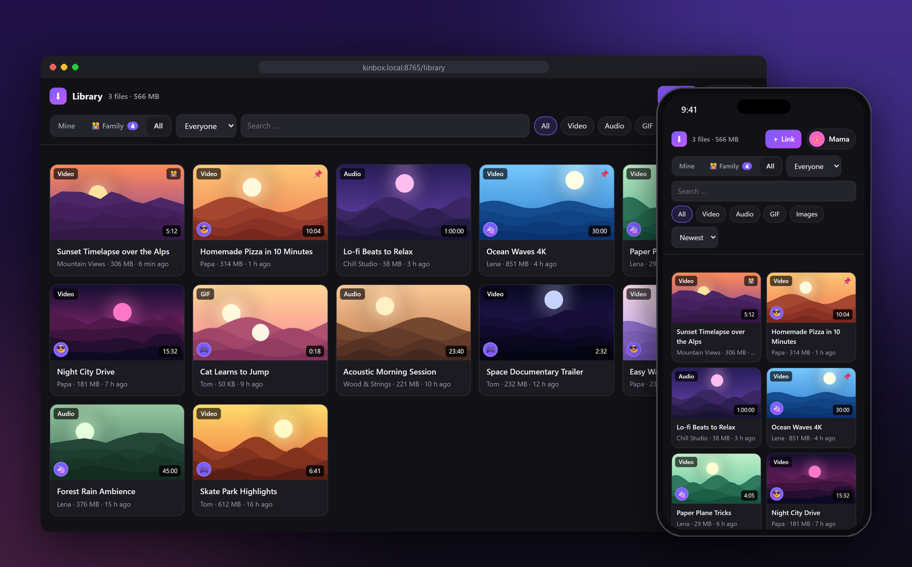
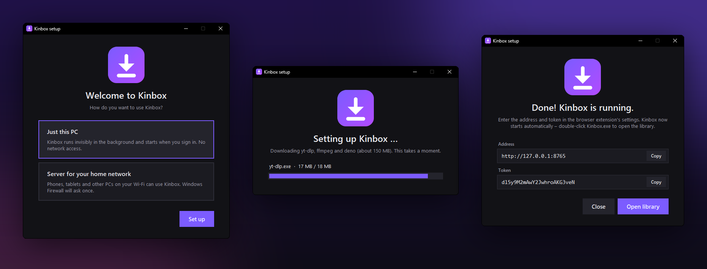
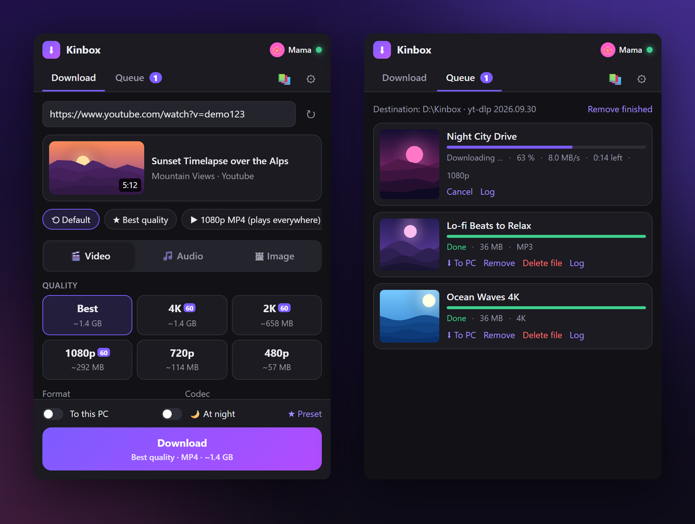
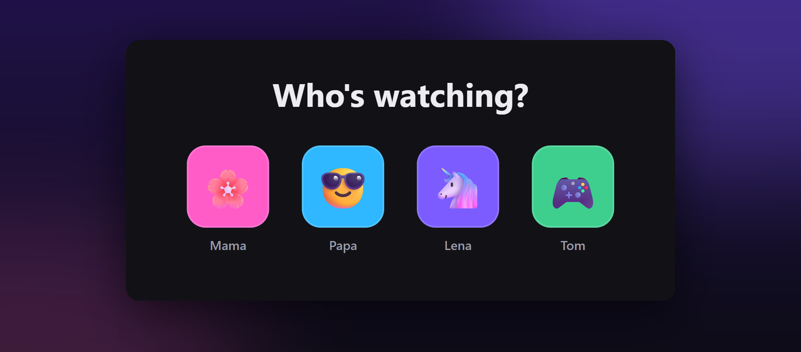

<div align="center">


# Kinbox

**The family media box**

Save videos and music from YouTube, TikTok & 1,000+ sites to your own PC with one click –<br>with a browser extension, a web library and a profile for everyone. No terminal needed.

[](https://github.com/B4turnatur/Kinbox/releases/latest)
[](https://github.com/B4turnatur/Kinbox/releases)
[](LICENSE)
<br>


🇬🇧 **English** · 🇩🇪 [Deutsch](README.de.md)

<h3>
  <a href="https://github.com/B4turnatur/Kinbox/releases/latest">⬇️ Download Kinbox.exe</a>
  &nbsp;·&nbsp;
  <a href="#1-install-the-server-once">🚀 Get started</a>
  &nbsp;·&nbsp;
  <a href="#-family--profiles">👨‍👩‍👧 Family</a>
</h3>

<br>



https://github.com/user-attachments/assets/62fb7eb1-e7ff-404e-94bf-f0cfa957e14a

</div>

<br>

<table>
<tr>
<td width="33%" valign="top">

### 🎬 One click
A Kinbox button right on YouTube, TikTok, Instagram, X and Reddit – or right-click on any page.

</td>
<td width="33%" valign="top">

### 🎚️ Every option
Up to 8K & 60 fps, MP3/FLAC, trimming, chapters, subtitles, playlists, GIF or small for WhatsApp.

</td>
<td width="33%" valign="top">

### 📚 Your own library
Search, play and save to your phone – in the browser, installable as an app.

</td>
</tr>
<tr>
<td valign="top">

### 👨‍👩‍👧 For the whole family
“Who's watching?” with PIN, own folder, sharing, storage quotas and invite links.

</td>
<td valign="top">

### 🧹 Cleans up after itself
After saving to a device, after X days or above a size – per person, 📌 to keep.

</td>
<td valign="top">

### 🏠 Stays at home
Runs on your PC, no cloud, no account. Just this PC or your whole home network.

</td>
</tr>
</table>

<details>
<summary><b>📋 All features</b></summary>

- **Video:** best quality up to 8K, MP4/MKV/WebM/MOV, H.264/H.265/VP9/AV1, prefer 60 fps, size estimate per quality
- **Audio:** MP3, M4A, Opus, FLAC, WAV, 96–320 kbps, loudness normalization, **music mode** (clean artist/title tags, square cover)
- **Trim** with sliders or "⏱ now" (takes the position of the video playing in your tab), **chapters**, **playlists** (`1-5,8,10-`), **subtitles**, **SponsorBlock**
- **Convert** to GIF or shrink to 8 MB (Discord), 15 MB (WhatsApp), 25 MB (email) …
- **Video + MP3 in one go** (preset or switch "Also save as audio file") – e.g. the MP4 for OBS and the MP3 for Voicemod
- **Edit later in the library:** open a file → ✂ *Edit* → trim (with "Now" from the player), save as audio / change format, convert to MP4, GIF, shrink, remove sound, rotate, normalize volume. The result appears as a new file; the original stays unless you turn off "Keep the original".
- **Folder layouts:** flat, by channel, **Plex/Jellyfin** (channel › season year › episode) or music (artist › title)
- **Download at night** (scheduled window), duplicate warning, 10 built-in presets plus your own
- **One-click buttons** on YouTube, TikTok, Instagram, X and Reddit, right-click menu, keyboard shortcuts, notifications with "Save to this PC". The floating button can be moved to any corner of the video or hidden per site (button menu ▾ or *Settings → Behavior*)
- **Your look**: four styles (Classic, Clean, Paper, Terminal) and eight accent colors with clean line icons – in the extension under *Settings → Appearance*, in the library per profile under *your profile → Appearance*
- **Web library** (works great on phones, installable as a PWA): search, filter, play, download to the device, 📌 keep
- **Organize:** ⭐ favourites and your own **collections** (e.g. "Kids songs") – per person, also with files the family shared; files stay where they are. **Rename** (optionally the file too). **Select** → add many files at once to a collection or favourites, share, keep, download or delete them
- **Family profiles:** "Who's watching?" with optional PIN, a folder, library, queue and clean-up rules for each person, sharing with the family, storage quotas, invite links, multiple admins
- **Automatic clean-up** per person: after downloading to a device, after X days, or above a size limit
- **Photo posts:** Instagram pictures and carousels, TikTok photo slideshows (with their music), X, Reddit & co. – just press Download, Kinbox switches to [gallery-dl](https://github.com/mikf/gallery-dl) by itself. A post with several pictures gets its own folder and shows up in the library as one album – "All to this device" saves every picture at once. Instagram usually needs cookies (see below)
- **Profile pictures & TikTok sounds:** open an Instagram or TikTok profile, pick "Image" – Kinbox saves the profile picture. In audio mode, "TikTok: music only" saves just the song instead of the original sound with voice
- **Android app:** Share → Kinbox from YouTube, TikTok & co., with every option of the extension (including trimming) – iPhone via the Shortcuts app

yt-dlp supports 1,000+ sites, and the popup and right-click menu work on all of them.

</details>

## 1. Install the server (once)

### Easiest: Kinbox.exe (Windows, no Python needed)

1. Download **`Kinbox.exe`** and **`Kinbox-Extension.zip`** from the [latest release](https://github.com/B4turnatur/Kinbox/releases/latest).
2. Put `Kinbox.exe` in its own folder, e.g. `C:\Kinbox`, and double-click it. Windows may warn "Windows protected your PC". Click **More info → Run anyway**. The exe isn't signed.
3. A setup window opens. Choose **Just this PC** or **Server for your home network** and click **Set up**. Kinbox downloads yt-dlp, gallery-dl, ffmpeg and deno (about 160 MB) into `tools\`. For the home network, allow access when the Windows firewall asks.
4. The window shows the **address** and **token** for the extension (with copy buttons). Kinbox starts automatically when you sign in. Double-clicking `Kinbox.exe` again opens the library.

<p align="center"></p>

To update yt-dlp, click "Update yt-dlp" in the extension settings.

To update **Kinbox itself**: open the library as admin → ⚙ → **Server** → "Update now". Kinbox downloads the latest release and restarts on its own (works for `Kinbox.exe` and for the Python install; wait until running downloads have finished). The browser extension is updated separately.

### Windows with Python (install.bat)

1. Copy the `server` folder anywhere, e.g. `C:\Kinbox`.
2. **Right-click `install.bat` → "Run as administrator".**
   It installs Python (if needed), yt-dlp, gallery-dl, Flask, Waitress, ffmpeg and deno.
   If Python was just installed, run `install.bat` a second time.
3. Choose how you want to use Kinbox:
   - **1 = Only this PC (standalone)** – for people with just one computer. Kinbox runs invisibly in the background, starts when you sign in, and can't be reached from the network. No admin rights needed. The installer shows the **token**. In the extension, use the address `http://127.0.0.1:8765`. A "Kinbox" desktop shortcut opens the library.
   - **2 = Server for the home network** – for phones and other PCs. Opens port 8765 in the firewall (private networks only) and can set up autostart at boot (also without sign-in). Then start `start.bat`. The window shows the **token** and the download folder. Find the PC's IP address with `ipconfig` → "IPv4 Address", e.g. `192.168.178.20`.
4. Sign out and back in once, so Windows finds ffmpeg/deno.

You can switch later by running `install.bat` again. Set up autostart afterwards: right-click `autostart.bat` → "Run as administrator". The token is also in `settings.json`.

> The installer scripts are in German. They only show a few short status messages.

### Docker / NAS (Portainer, Synology, Unraid …)

No Windows PC needed – Kinbox runs as a container with ffmpeg and deno included (amd64 + arm64).
In Portainer: **Stacks → Add stack**, paste [`docker-compose.yml`](docker-compose.yml), adjust the two folders on the left, **Deploy**.

```yaml
services:
  kinbox:
    image: ghcr.io/b4turnatur/kinbox:latest
    restart: unless-stopped
    ports: ["8765:8765"]
    volumes:
      - ./kinbox-data:/data            # settings, profiles, library
      - ./kinbox-downloads:/downloads  # your videos
```

The admin token is in the container log (Portainer → Containers → kinbox → Logs) and in `kinbox-data/settings.json`.
The library at `http://<NAS-IP>:8765/library` works as usual – both update buttons (yt-dlp and Kinbox) too; Kinbox restarts the container by itself. Pulling a newer image (Portainer: *Recreate → Re-pull image*) also updates.

**Away from home:** use a VPN such as [Tailscale](https://tailscale.com) – never forward the port. In the extension and Android app, enter the Tailscale address as *Away address*; Kinbox switches automatically when the home address doesn't respond.

### Linux / macOS

```bash
pip install "yt-dlp[default]" gallery-dl flask waitress   # plus ffmpeg and deno from your package manager
python3 server/server.py
```

## 2. Install the browser extension

1. Open `chrome://extensions` (Edge: `edge://extensions`).
2. Turn on **Developer mode** (top right).
3. **"Load unpacked"** → select the `extension` folder (or the unzipped `Kinbox-Extension.zip`).
4. The settings page opens. Enter the address (`http://192.168.178.20:8765`) and the token, then click **Save & test**.
5. Tip: pin the extension via the puzzle icon.

<p align="center"></p>

Shortcuts: **Alt+Shift+D** popup · **Alt+Shift+Q** download the current page · **Alt+Shift+M** as MP3 (change them at `chrome://extensions/shortcuts`).

## 3. Android app (optional)

1. Download **`Kinbox.apk`** from the [latest release](https://github.com/B4turnatur/Kinbox/releases/latest) on your phone and open it. Android asks once whether to allow installing from this source – tap **Allow**.
2. Connect it: long-press your **invite link** (e.g. in WhatsApp) → **Share → Kinbox**. Or open the library on your phone → profile → **Set up Android app → Connect with the app**.
3. From now on: in YouTube, TikTok, Instagram or the browser tap **Share → Kinbox**. You get the same options as in the extension – quality, audio, trimming with a preview player, chapters, presets, queue – and "To phone" saves the file to `Downloads/Kinbox`.

Only works on the home Wi-Fi. Notifications for finished downloads arrive while the app is open.

## 👨‍👩‍👧 Family & profiles

<p align="center"></p>

**Add a person (admin):** library → your profile (top right) → **Family** → name, picture, optional PIN and quota → **＋ Add** → **✉ Invite**. The invitation contains a link that signs the person in directly, plus the address and token for the extension.

- *Mine* = your own files · *Family* = files others shared · *All* = admins only
- Each person gets their own subfolder (`Downloads/Kinbox/<name>`); the admin keeps the main folder
- **New key** invalidates a person's old links and extension access (e.g. a lost phone)
- **Privacy:** admins can see everyone's files under *All*. Let your family know.

## Server settings (`server/settings.json`)

This file is created on first start. Restart the server after editing it.

| Key | Meaning |
|---|---|
| `port` | default 8765 |
| `token` | admin profile key (all profiles live in `users.json`) |
| `download_dir` | target folder, e.g. `"D:\\Media\\Downloads"` |
| `max_parallel` | simultaneous downloads |
| `cookies_file` | path to a `cookies.txt` for age-restricted/members-only videos, Instagram, or YouTube's bot check |
| `ffmpeg_location` | folder containing ffmpeg if it isn't on the PATH |
| `extra_args` | extra yt-dlp arguments for every download |
| `site_args` | extra arguments for specific sites (includes a TikTok fix) |
| `night` | night window, e.g. `{"start": "01:00", "end": "07:00"}` |

**Cookies:** log in in your browser, export a `cookies.txt` with an extension like "Get cookies.txt LOCALLY" and pick it in the library under ⚙ → Server → **Upload cookies.txt** – that's it. You can upload several sites (e.g. Instagram and YouTube) one after another; they get merged. Alternatively put the file on the server yourself and set `cookies_file`. Kinbox then uses them automatically for every download (phone shortcuts included). You may also point it at the folder containing `cookies.txt`.

## Troubleshooting

- **"Server not reachable":** is `start.bat` running? Is the IP right? Did you run `install.bat` as admin (firewall)? Open `http://IP:8765` in a browser. On Windows the network must be set to **private**.
- **YouTube downloads suddenly fail:** Settings → "Update yt-dlp".
- **Windows Defender reports `Kinbox.exe` as a trojan (e.g. `Bearfoos!ml`):** a false positive of the AI heuristic – unsigned tools that download programs and start with Windows look suspicious to it. Versions before 3.5.1 triggered it more often (hidden PowerShell); please update. You can report the file to Microsoft as a false positive: [microsoft.com/wdsi/filesubmission](https://www.microsoft.com/wdsi/filesubmission). The source code is all in `server/server.py`.
- **"Sign in to confirm you're not a bot" / Instagram "login required":** set up cookies (see above).
- **No "Kinbox" button on TikTok etc.:** reload the page and check *Settings → Behavior → Show on*. The right-click menu and the popup always work.
- **The floating button covers something:** button menu ▾ → "Move button to another corner" or "Hide on this site".
- **A video won't play in the library:** the browser can't play that format (e.g. MKV/H.265). Download it to the device instead, or choose MP4.
- **Error details:** queue → "Log" on the job.

## Security & legal

Kinbox is meant for your home network. **Do not** forward port 8765 on your router. To use it on the go, use a VPN such as Tailscale or WireGuard.
Only download content you're allowed to download, and respect the sites' terms of service and copyright law.

## Development

No build step. `server/server.py` is a single-file Flask app. `server/static/library.html` is the web library. `extension/` is a plain Manifest V3 extension.
`android/` is the Android app (Kotlin, `./gradlew assembleDebug`): a WebView that shows the extension's popup and settings (`android/src/main/assets/app.js` replaces the `chrome.*` APIs), so both always have the same features.
Translations live in `extension/lib/i18n.js`. `server/static/i18n.js` must be an identical copy. Run `node tests/test_i18n.mjs` to check both.

## License

[MIT](LICENSE). Kinbox uses [yt-dlp](https://github.com/yt-dlp/yt-dlp), [gallery-dl](https://github.com/mikf/gallery-dl), [ffmpeg](https://ffmpeg.org) and [deno](https://deno.com). They are installed separately and come with their own licenses.
